# Hush Lake

A first-person cozy ice-fishing incremental, made in Godot 4.7.

Something old lives under the ice of Hush Lake, and it is hungry. Drill holes, catch fish, push and throw your catch across the ice into the Eye, then build machines that do the work for you: auto-rods, belts, smokers, canneries, sorters, depots and ice-breaker rigs. Feed the Eye enough and it wakes.

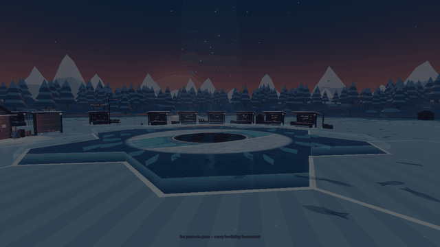

> **Status:** a finished prototype that is no longer being worked on. It runs and is playable start to finish, but expect rough edges. The screenshots are from development builds.

## Screenshots

| | |
|---|---|
| 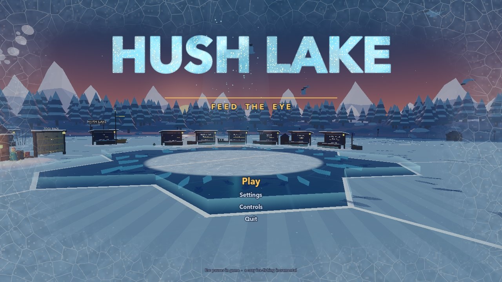 | 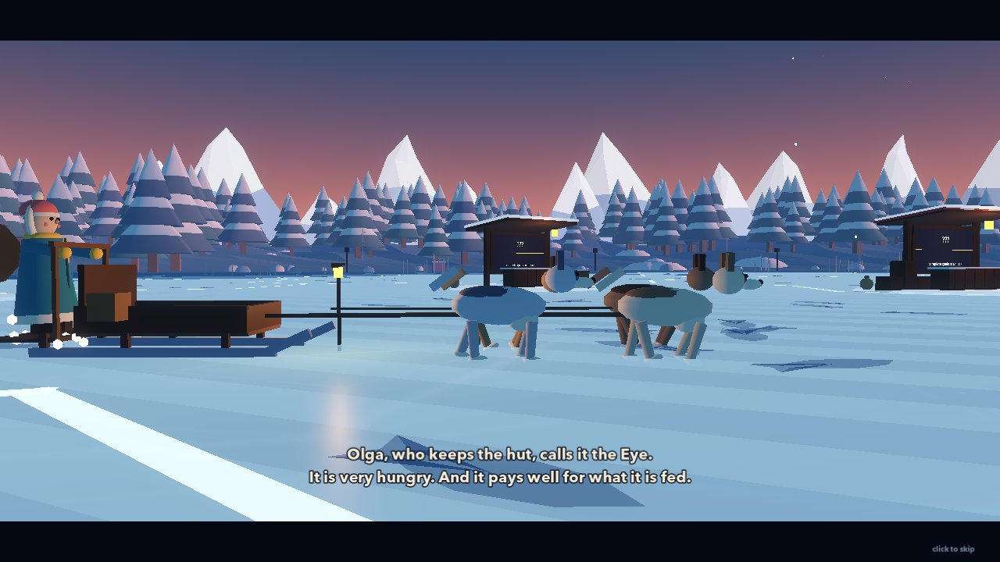 |
| 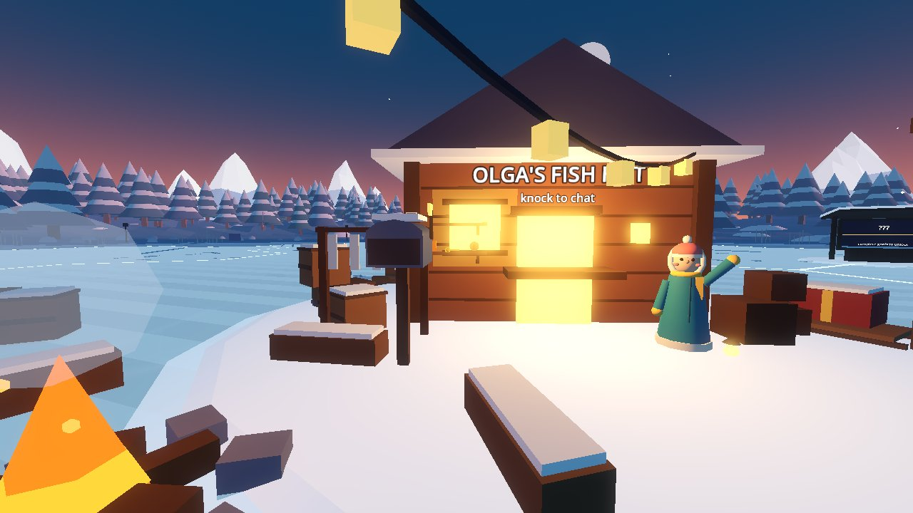 | 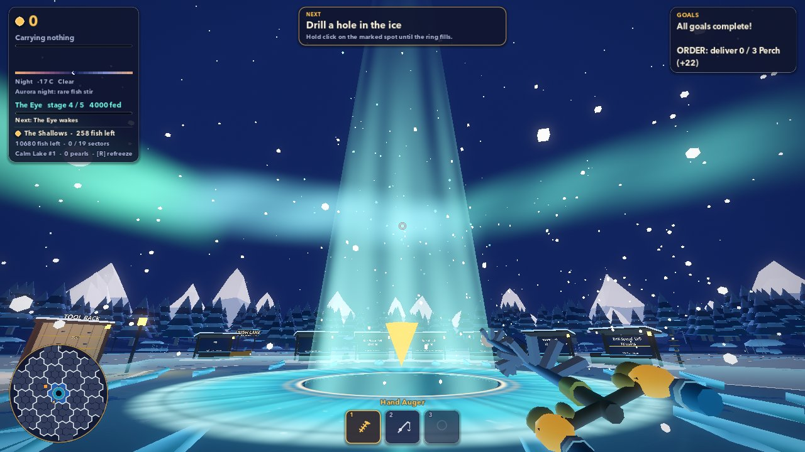 |
| 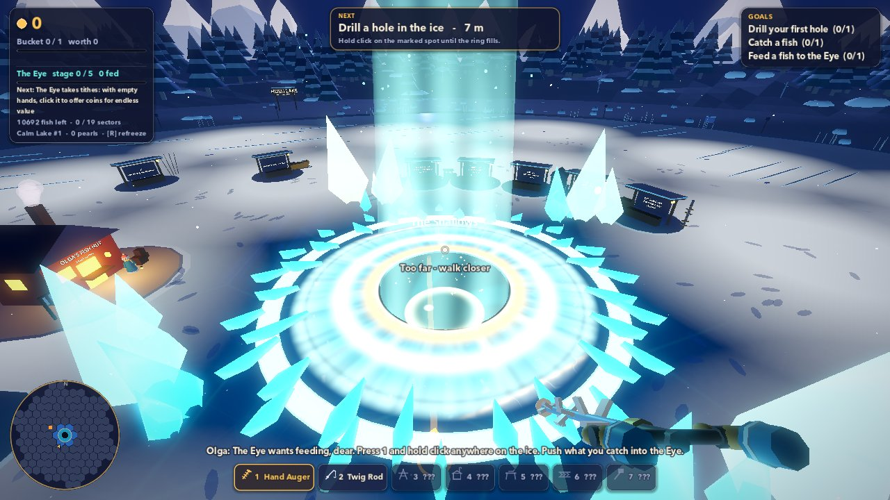 | 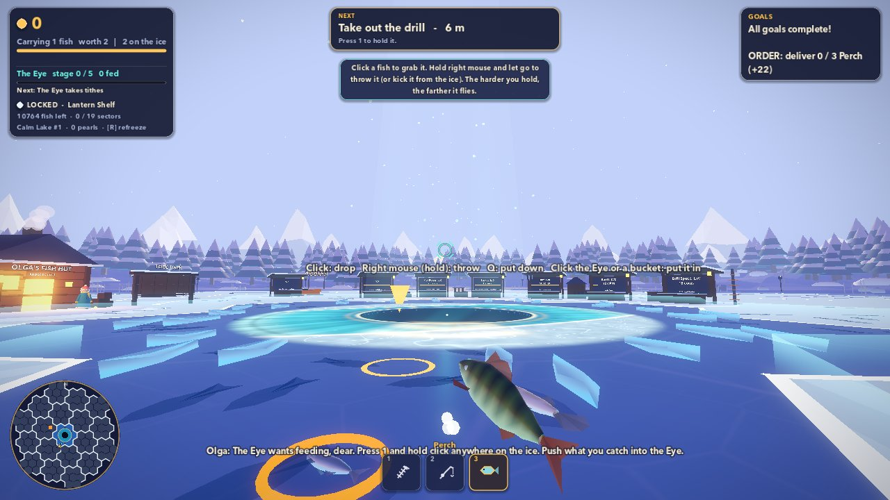 |
| 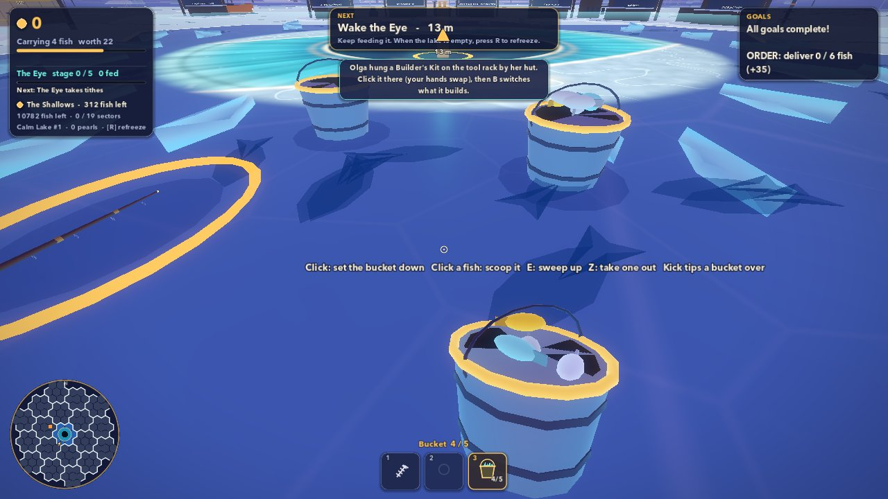 | 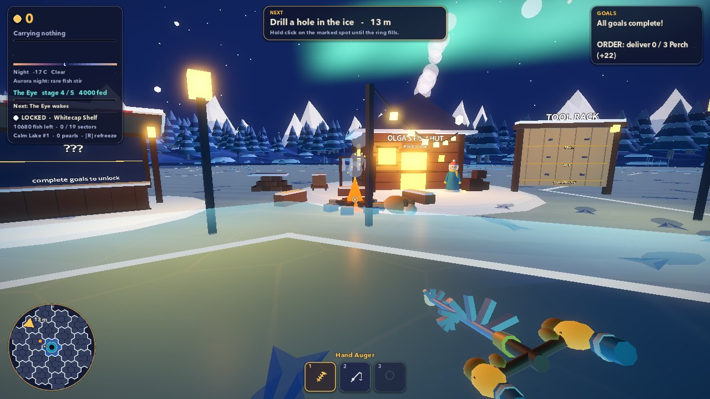 |
| 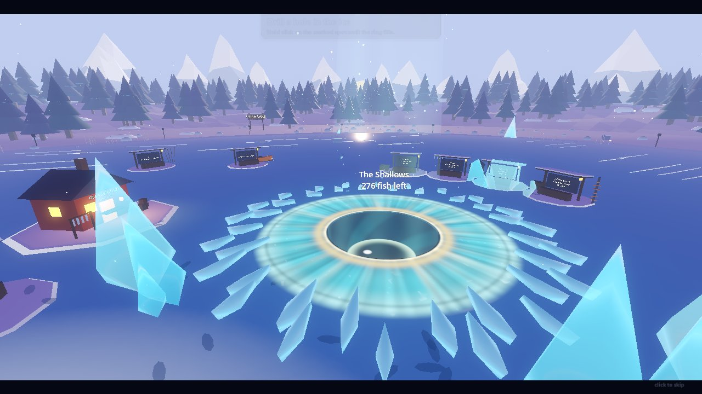 | 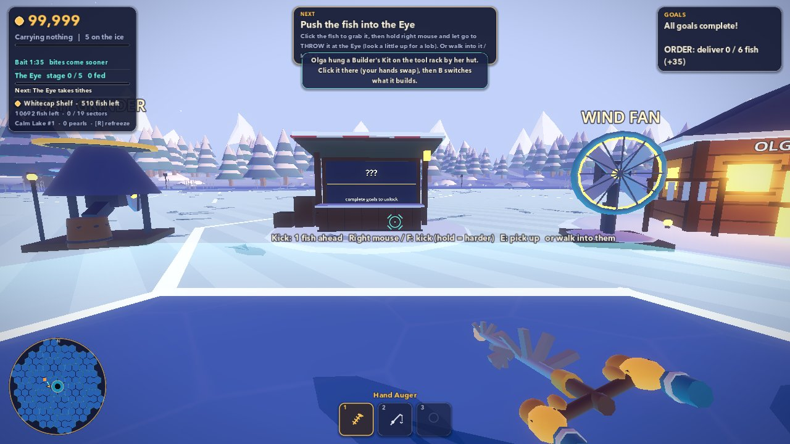 |

## How it plays
- **Fish anywhere.** Drill through the ice, cast, wait for a bite and fight the fish in.
- **Everything is physical.** Caught fish drop onto the ice and slide. Grab them, carry three things at once, throw them in an arc, kick them, or sweep them into buckets.
- **Feed the Eye.** Every fish you deliver grows it through five stages, each with its own reward, until it wakes.
- **Automate.** Build auto-rods, belts with real back-pressure, splitters, chutes, smokers, gut tables, canneries, sorters, depots, bait grinders, wind fans and ice-breaker rigs. Then ride a snowmobile out to the far sectors.
- **A small story.** Olga, who has watched the Eye for forty winters, leaves letters in the mailbox. There are dreams, keepsakes and an ending.
- **A living lake.** Day and night, weather (snow, fog, blizzards, aurora nights), visiting rare fish, a field journal and a photo mode.
- **Keep going.** Refreeze the lake and choose what the next one is like, with perks and a ledger of lifetime goals.

## Play
Install [Godot 4.7](https://godotengine.org/), then run `tools/run.sh` (or open `project.godot` in Godot and press F5). The game opens on a title (Hush Lake at dusk, the title forming out of frost); Play runs a short sled-ride opening (click to skip), Continue a "previously" beat. Esc opens the menu (Settings: look & feel, interface, audio, video; Controls; How to play; Lake stats).

| Key | Does |
|---|---|
| WASD | walk (walk into fish to push them) |
| 1 2 3 / mouse wheel | the slot in your hand: you carry THREE things (a tool, a fish or a bucket) and hold one |
| left click on a fish | GRAB it: into the bucket you hold, else into a free slot (it hangs in your hand and sways as you turn); click empty ice to drop it |
| hold right mouse, let go | THROW the fish in your hand (arc preview; look up a little for a lob); with anything else in hand it is a kick (a kick tips a placed bucket over) |
| click | use the tool in hand (Drill, Rod, Builder's Kit) / buy / feed |
| click the Eye, a depot or a smoker | give it everything you carry (loose fish and whole buckets) |
| F | same as right mouse |
| throw at a depot, a smoker or a placed bucket | it goes in |
| Q | put what you hold down (a fish slides off; a tool or bucket stays where it lands) |
| E | pick up what you look at (a tool or bucket on the ice), else sweep the fish at your feet into your buckets, then your hands |
| Z | take one fish out of the bucket in your hand (needs a free slot) |
| click a bucket on the ice | put the fish in your hand into it, or take one out |
| B | the Builder's Kit does one build at a time: switch it (Auto-Rod, Smoker, Gut Table, Belt, Cannery, Sorter, Depot, Ice-Breaker, Bait Grinder, Wind Fan) |
| throw or click a fish into a Bait Grinder | it becomes bait: every bite comes sooner for a while |
| H | ask Olga what to do next |
| V | snowmobile once bought |
| Tab | field journal |
| F5 | (debug) cycle the weather |
| R | refreeze (after clearing sectors) |
| M | mute |
| P | photo mode: hides the interface, scroll zooms, click or Enter saves a picture to `user://photos/` |
| L | the Ledger: lifetime goals that pay pearls |
| click the mailbox | read Olga's letters (A/D turn the page, E closes) |
| Z X C (at the refreeze card) | choose the next lake's character |

Notes for playtesters are in `PLAYTEST.md` (what to look for, what to write down).

## Checks (no human needed)
`tools/run_yard.sh` (fish physics) · `run_opening.sh` (title, sled run, skip, previously) · `run_weather.sh` (weather, sky, life, camp) · `run_machines.sh` (bait grinder, wind fan) · `run_hands.sh` (the three slots, grab, throw, buckets, tools on the ice, the rack) · `run_sectors.sh` (sector borders and states) · `run_ui.sh` (menu, settings, HUD feel) · `run_safety.sh` (saves, offline, pause) · `run_guide.sh` (onboarding) · `run_audio.sh` (sound levels) · `run_smoke.sh` (everything, several minutes) · `first10.sh` (a bot plays the first 10 minutes) · `play_bot.sh` (windowed, real input) · `perf_render.sh` (rendered frame times) · `shot.sh` / `opening_shot.sh` / `showroom.sh` (screenshots).

## Docs
`docs/STYLE.md` (the look), `docs/DECISIONS.md` (why things are the way they are), `docs/BALANCE.md`, `docs/ROADMAP.md`.

## Art, sound, story and progression pipeline (tools)
- `tools/refshots.sh` renders 20 fixed clean frames; GPT agents turn each into reference images (`docs/ART_PIPELINE.md`, `docs/refs/`); Claude rebuilds the scene from the delta list (`docs/refs/DELTA.md`); `tools/contact_sheet.py` and `tools/refs_pack.py` build and shrink the before | reference | after sheets.
- The score (`shared/score.gd`), the visitor fish and journal (`visitors.gd`), the story (`story.gd`, `docs/STORY.md`), the Ledger (`ledger.gd`). Suites: `tools/run_score.sh`, `run_fishing.sh`, `run_story.sh`, `run_progress.sh`.

## Run everything
`tools/run_all.sh` runs every headless suite with a one-line verdict each (`quick` skips the long smoke, econ and first10 runs; `bots` adds the windowed real-input bot, which needs the window in front). Logs land in `/tmp/run_all_*.log`.
